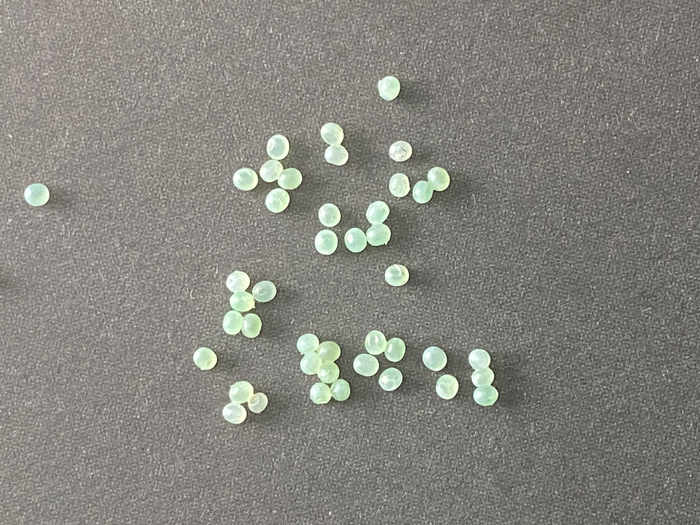
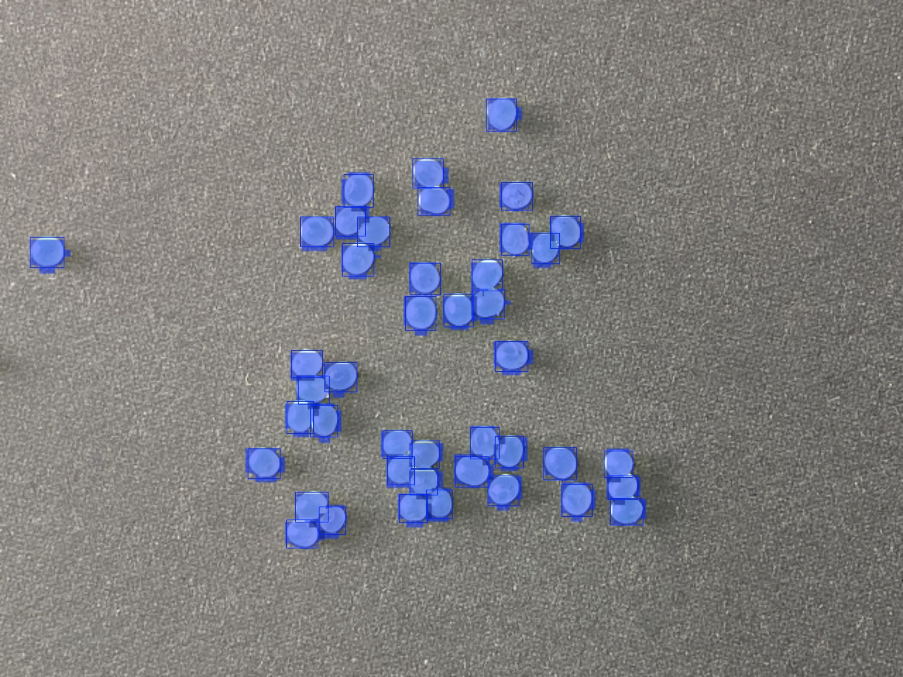
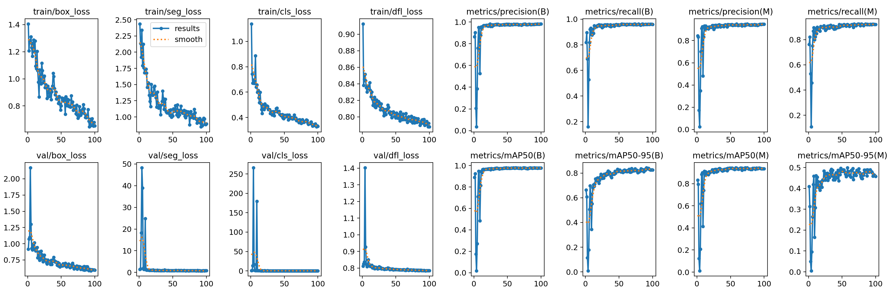

# Manduca Egg Counter

**YOLOv8m-seg for counting tobacco hornworm (*Manduca sexta*) eggs in laboratory photographs.**

[Русская версия](README.md) · [Methodology](docs/methodology.md) · [Recorded metrics](reports/train/results.csv)

Research by **G. A. Potapov**, with ITMO University and the All-Russian Institute of Plant Protection affiliations stated in the author's abstract.

The workflow combines polygon annotation in CVAT, COCO-to-YOLO conversion, instance segmentation and a Telegram interface. The repository packages the research artifacts with portable inference and training entry points.

| Input | Segmentation output |
|:--:|:--:|
|  |  |

The local demo detected **43 objects** at confidence 0.4. This is a model prediction, not a manually verified count.

## Recorded results

At epoch 74 of the saved `train` run:

| Metric | Boxes | Masks |
|:--|--:|--:|
| Precision | 0.98026 | 0.94350 |
| Recall | 0.96207 | 0.92586 |
| mAP@0.50 | 0.97940 | 0.94344 |
| mAP@0.50:0.95 | 0.83412 | 0.48711 |

These are recorded validation metrics, not counting accuracy or a new independent evaluation. Counting MAE/RMSE have not been measured. The saved run used 100 epochs and patience 200; the abstract states 80 and 50 respectively. Epoch 74 has the highest box mAP50 in the saved log; it is not necessarily the epoch selected by the checkpoint fitness criterion.



## Run locally

```bash
python3 -m venv .venv
source .venv/bin/activate
python -m pip install -r requirements.txt
python predict.py examples/input.jpg --weights weights/best.pt --device cpu
```

Trained single-class `egg` weights are required. They are available in the prepared local copy but excluded from Git; a public download has not been published. Output includes an annotated image and a JSON count. Default inference settings: confidence 0.4, image size 640, maximum 1,000 detections.

For the Telegram interface, set `TELEGRAM_BOT_TOKEN` in the process environment and run `python bot.py`. Never commit tokens. Live Telegram operation has not been tested during packaging.

To train, place YOLO segmentation data under `data/train/{images,labels}` and `data/validation/{images,labels}`, then run:

```bash
python train.py --data configs/data.yaml --epochs 100 --patience 200
```

Local YOLO folders contain 172 training and 64 validation images with 15,231 annotated objects in total. The original COCO export has a different 186/50 split. Data and weights are not included in Git. No independent test set has been established.

See [provenance](docs/provenance.md) for third-party tools and packaging changes. No project-wide license has been selected yet.
