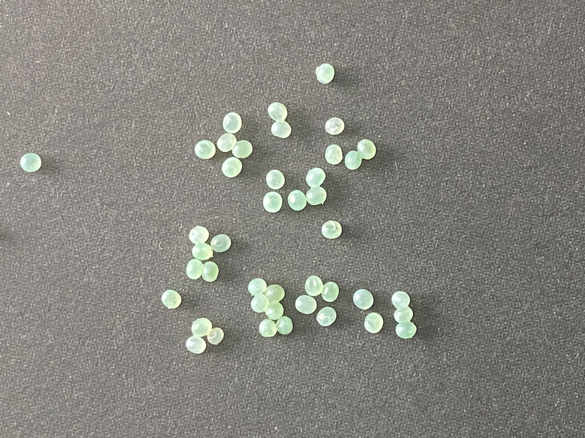
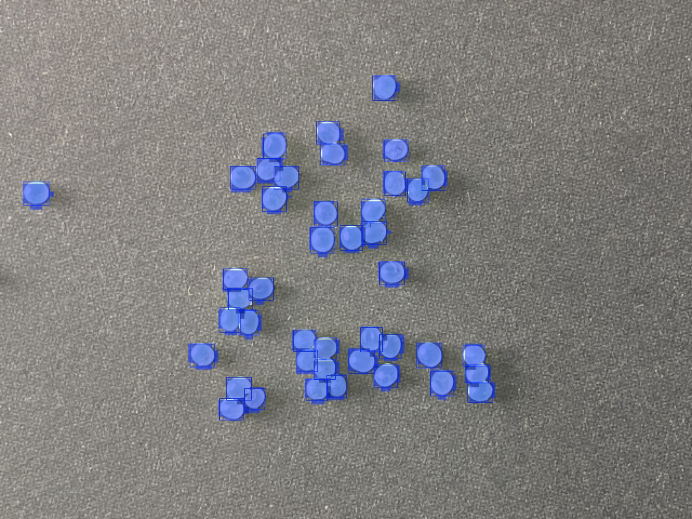
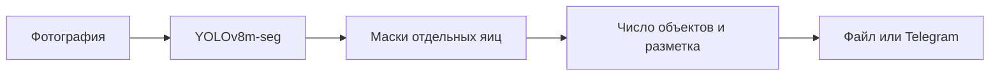
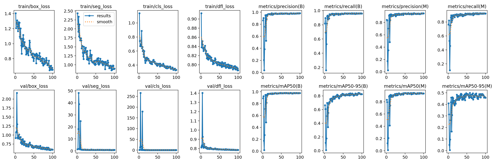
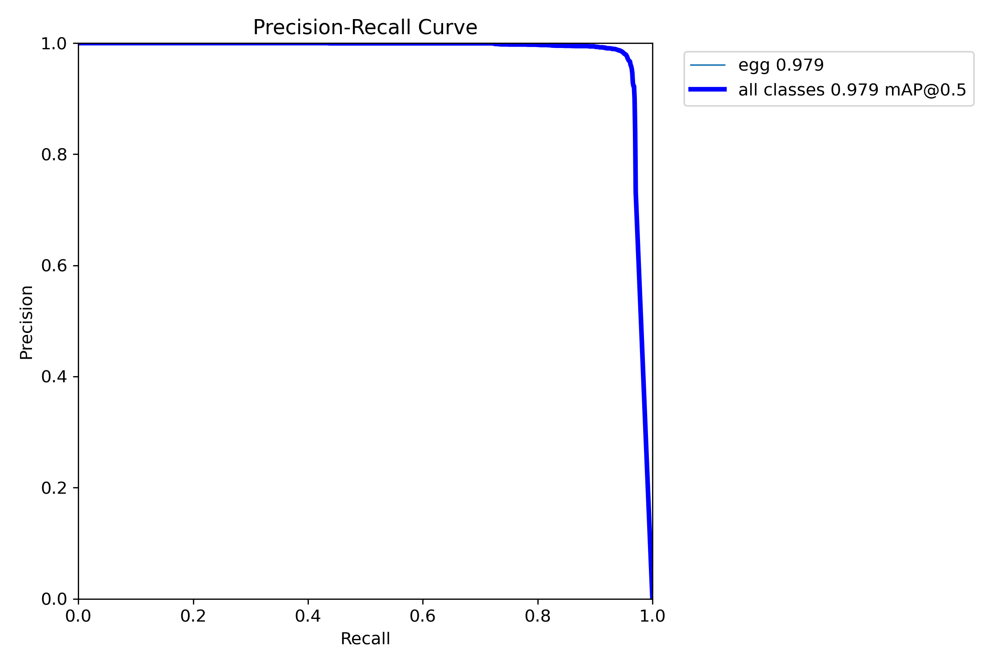
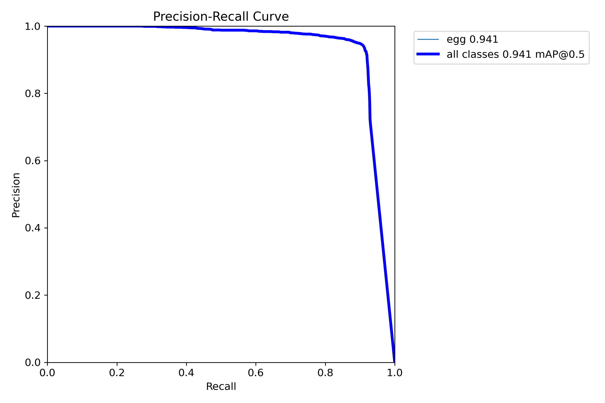
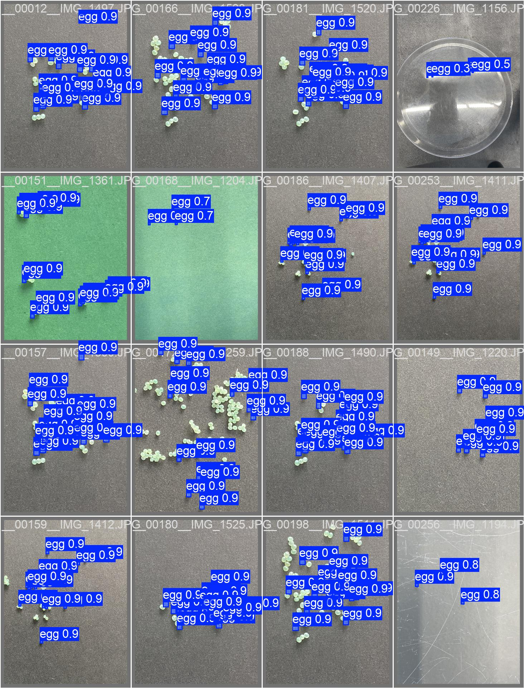

<div align="center">

# Manduca Egg Counter

### От фотографии к подсчёту яиц

Компьютерное зрение для лабораторного культивирования **Manduca sexta**.
Сегментация отдельных яиц с YOLOv8m-seg и интерфейс в Telegram.

**Python · Ultralytics YOLOv8 · OpenCV · CVAT · Telegram**

[Результаты](#результаты) · [Запуск](#быстрый-запуск) · [Методика](docs/methodology.md) · [English](README.en.md)

</div>

---

## Задача

Ручной подсчёт яиц табачного бражника трудоёмок при оценке репродуктивной активности лабораторной культуры. Проект распознаёт отдельные яйца на фотографии, визуализирует найденные объекты и возвращает их количество. Telegram-бот позволяет использовать модель без отдельного пользовательского приложения.

**Автор исследования: Г. А. Потапов.** Работа выполнена в контексте ИТМО и Всероссийского института защиты растений, как указано в авторских тезисах. Это исследовательский прототип; результат подсчёта требует проверки специалистом.

## Пример работы

| Исходная фотография | Сегментация YOLOv8m-seg |
|:--:|:--:|
|  |  |

На этом примере локальное демо обнаружило **43 объекта** при `conf=0.4`. Это результат модели, а не подтверждённый ручной подсчёт.

## Как это работает



Подготовка данных: разметка полигонов в CVAT → экспорт COCO → конвертация в формат YOLO → обучение модели. В репозитории также сохранён ранний эксперимент с преобразованием Хафа.

## Результаты

Значения из сохранённого журнала `train`, **эпоха 74**. Метрики детекции совпадают с авторскими тезисами.

| Метрика | Детекция, boxes | Сегментация, masks |
|:--|--:|--:|
| Precision | 0,98026 | 0,94350 |
| Recall | 0,96207 | 0,92586 |
| mAP@0.50 | **0,97940** | **0,94344** |
| mAP@0.50:0.95 | 0,83412 | 0,48711 |

Источник: [полный журнал обучения](reports/train/results.csv). mAP характеризует качество обнаружения/сегментации и **не является процентом верно подсчитанных яиц**. MAE и другие метрики ошибки подсчёта на независимом тесте пока не рассчитаны.

<details>
<summary>Кривые обучения и предсказания из сохранённого эксперимента</summary>



| Детекция: precision–recall | Сегментация: precision–recall |
|:--:|:--:|
|  |  |



</details>

**Примечание о воспроизводимости.** В тезисах указаны 80 эпох и `patience=50`; сохранённый запуск содержит 100 эпох и `patience=200`. Лучшее значение mAP50 детекции в этом журнале находится на эпохе 74. Новая команда обучения использует сохранённую конфигурацию. Происхождение и ограничения описаны в [методике](docs/methodology.md).

## Данные

В локальной YOLO-разметке обнаружены **236 изображений и 15 231 объект класса `egg`**:

| Выборка | Изображения | Объекты |
|:--|--:|--:|
| Обучение | 172 | 11 670 |
| Валидация | 64 | 3 561 |

Каждому изображению соответствует файл разметки. Точных дубликатов файлов изображений между этими папками не найдено; независимость сцен этим не подтверждается. Исходный COCO-экспорт имеет другое разбиение: 186/50 изображений. Аудит: [dataset_summary.json](reports/dataset_summary.json).

Полный датасет и веса исключены из Git. Включён один пример фотографии без EXIF-метаданных. Независимая тестовая выборка не установлена.

## Быстрый запуск

Команды выполняются из корня проекта. Рекомендуется Python 3.11–3.13; локальная проверка выполнялась с Python 3.13 и Ultralytics 8.3.95.

```bash
python3 -m venv .venv
source .venv/bin/activate
python -m pip install -r requirements.txt
```

Поместите обученные веса класса `egg` в `weights/best.pt`. В подготовленной локальной копии они уже есть, но **в GitHub не загружаются**. После клонирования получите их у автора: публичная ссылка на скачивание пока не опубликована.

```bash
python predict.py examples/input.jpg --output outputs/prediction.jpg --device cpu
```

Результат — изображение с разметкой и JSON с числом обнаруженных объектов. Для Apple Silicon можно явно выбрать `--device mps`. Порог по умолчанию — `0.4`, размер обработки — `640`, лимит — `1000` объектов. Эти параметры относятся к демо и не воспроизводят автоматически валидационные метрики выше.

### Telegram-бот

Создайте бота через BotFather и задайте токен в окружении. Например, в bash можно ввести его без отображения на экране и сохранения в истории команд:

```bash
read -s -p 'Telegram token: ' TELEGRAM_BOT_TOKEN
export TELEGRAM_BOT_TOKEN
python bot.py
```

Отправьте боту `/start`, затем фотографию. Бот возвращает изображение и число найденных яиц. Временные фотографии удаляются после обработки. Telegram может сжимать фото, что способно влиять на результат. Код бота переработан для публикации; проверка с реальным аккаунтом Telegram ещё не проведена. `.env.example` служит подсказкой: автоматической загрузки `.env` нет.

### Повторное обучение

Разложите собственную YOLO-seg-разметку по папкам:

```text
data/
├── train/
│   ├── images/
│   └── labels/
└── validation/
    ├── images/
    └── labels/
```

```bash
python train.py --data configs/data.yaml --epochs 100 --patience 200
```

Первое обучение загружает исходные веса `yolov8m-seg.pt` и требует интернета. Параметры `imgsz=640`, `batch=8`, `seed=0` заданы в скрипте. Готовые артефакты сохраняются в `runs/segment/`.

## Структура

```text
manduca-egg-counter/
├── predict.py              # Подсчёт и визуализация на одном изображении
├── bot.py                  # Telegram-интерфейс
├── train.py                # Запуск обучения
├── configs/data.yaml       # Переносимые пути к датасету
├── examples/input.jpg      # Пример без EXIF
├── notebooks/              # Ранний эксперимент с методом Хафа
├── reports/                # Сохранённые метрики и аудит данных
├── docs/                   # Методика, иллюстрации и происхождение кода
└── weights/                # Локальные веса, исключённые из Git
```

## Ограничения и развитие

- Тесные скопления, перекрытия и изменения освещения могут вызывать пропуски и ложные срабатывания.
- Оценка на других видах чешуекрылых и независимых условиях съёмки не проводилась.
- Следующий шаг — измерить MAE/RMSE подсчёта, проверить разделение по сценам и подобрать порог на отдельной выборке.
- Проверка демо не заменяет повторное обучение и независимую оценку модели.

## Использованные инструменты и авторство

Модель: [Ultralytics YOLOv8](https://docs.ultralytics.com/models/yolov8/). Разметка: CVAT. Конвертация COCO: сторонний проект **Koldim2001/COCO_to_YOLOv8**; его исходники и копия CVAT в этот репозиторий не перенесены. Подробности: [происхождение материалов](docs/provenance.md).

Сохранённые журналы и иллюстрации относятся к исходной работе. Скрипты запуска и документация подготовлены при оформлении проекта. Лицензия на авторский код, данные и веса пока не выбрана; лицензия стороннего конвертера не переносится автоматически на этот проект.
